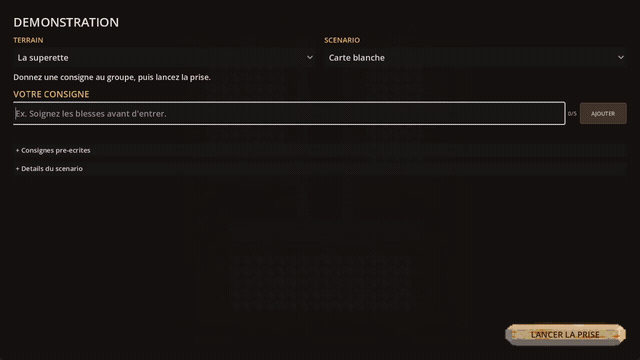

# Hordinary

*[Version française](README.md)*

**An LLM translates the player's orders, deterministic checks decide, autonomous agents plan.** In
this tactical survival game the player controls no one. They write, in French, *"Tend the wounded
before going in"*; a language model turns it into a formal constraint; four gates validate it,
compile it into PDDL and check every plan; and three agents, who only know what they perceive,
change the way they play.

<!-- Demo clip: see docs/enregistrer-la-demo.md, then uncomment the next line. -->
<!--  -->

---

## The LLM translates, it does not decide

```
"Soignez les blessés avant d'entrer."  (Tend the wounded before going in.)
      │  language service: FastAPI + LangGraph, through OpenRouter
      ▼
require_before(band_tended, enter:building)        a closed grammar of five forms
      │  gate 1: grammar, symbols and argument types                        (C#, deterministic)
      │  gate 2: compilation into preconditions of the PDDL domain
      │  gate 3: satisfiability proof by Fast Downward                      (offline)
      ▼
MoveToLocation(patient) -> TendAlly -> EnterBuilding(objective_zone) -> …   one agent's GBFS plan
      │  gate 4: trajectory check on every plan produced, corroborated by VAL
      ▼
execution, replanning, mission report
```

The model holds no authority: it proposes, the code decides. A model that gets it wrong breaks
nothing, it gets caught; neither does a missing model. The game runs without the service, on
pre-written orders that go through **exactly the same gates**. Every engineering decision around
the call (cache, spending cap, timeout, retry, fallback) lives in the C# core, and the transport is a
plain delegate: the core cannot reference an HTTP client, because there is nowhere to put one.

The player always sees **the compiled constraint**, not an acknowledgement, and a refusal is shown
in the same place as an acceptance, with the gate that produced it.

## Measured, not assumed

A corpus of **76 utterances**, a third of which *must* be refused: preferences dressed up as rules
(*"Be careful"*), conditionals (*"If a zombie spots you, run"*), a prompt injection, and orders that
are clear but inexpressible. Plus **24 held-out utterances**, written to check that the gain is not a
memorised corpus. Full write-up (in French): **[`service/evals/README.md`](service/evals/README.md)**.

Shipped model (`deepseek/deepseek-v4.1-flash`, reasoning off), **three draws per condition**:

| Corpus | Compiled | Exact | Correct refusals | **False accepts** | p95 |
|---|---|---|---|---|---|
| 74 corpus utterances | 94 % | 85 % | 87 % | **4 %** | 4.5 s |
| 24 held-out utterances | 94 % | 86 % | 76 % | **0 %** | 1.4 s |

The deciding column is **false accepts**: an inadmissible order translated anyway. Out of the
fifteen models submitted, `inference-net/schematron-v2-turbo` compiles 90 % of the utterances and
would top a table that only published that column. It translates *everything*, prompt injection
included: **85 % false accepts**.

What the measurements taught, and no review would have:

* **The ceiling was the prompt, not the model.** 163 translatable utterances refused against 29
  mistranslated. Three *definition* flaws in the system prompt, and a rewrite that takes one same
  model from 42 % to 78 % compiled, measured on a control where only the prompt changes.
* **Two ablations isolate each component.** Without the domain vocabulary sent to the model, 0 %
  compiled: it is not an aid, it is the substrate of the task. With three examples, +6 points
  compiled, −3 correct refusals: showing how to translate pushes towards translating.
* **A domain glossary** (one line of meaning per symbol) raises exact accuracy from 69 % to 85 % on
  the corpus, and **from 65 % to 86 % on held-out utterances**. Its price is published: false
  accepts go from 0 % to 4 %.
* **A single run lies.** At temperature zero, the model does not answer the same way twice. The
  first glossary run drew three wrong conclusions ("regressions" that were noise, a "0 %" that was
  luck); hence `--repeat 3`.
* **Latency decides before accuracy.** The best first-generation rates came with p95 of 22 s and
  267 s, against an 8 s timeout on the game side. Three of the newest models in the catalogue refuse
  to have reasoning disabled, which rules them out of real-time use.
* **The weakest model found a safety hole.** `nemotron-3-super` wrote a constraint whose argument
  had the wrong type; the gates accepted it, Fast Downward would have rejected it. Argument typing
  moved into gate 1: a gate must not accept what an external validator rejects.

The false accept that survives every condition is documented rather than hidden: *"Equip a weapon
before attacking"* becomes `equipped(objective)`. Well-formed, well-typed, satisfiable, and wrong.
Typing closes the wrong type, not the wrong referent; showing the constraint is what protects the
player.

## The agents that execute

Written from scratch, **with no external planning engine or AI library**:

| Layer | What it solves |
|---|---|
| **Utility AI** | Goal selection: 9 goals scored on considerations passed through response curves, with hysteresis. A goal is **data**: adding one recompiles nothing |
| **Symbolic planning** | State-space GBFS over 30 actions, instances of 8 primitive verbs described in JSON. The domain is exported as **valid, versioned PDDL** ([`tools/pddl/`](tools/pddl/)): a single compiler emits both the text Fast Downward reads *and* the domain the game executes |
| **Replanning** | Execution monitored at 2 Hz across 10 triggers; plan repair rather than full replanning; decision journal |
| **Partial observability** | No system reads the world on an agent's behalf: field of view, line of sight, hearing, and a mental map where a position ages and a memory decays |
| **Coordination** | Belief sharing within earshot (or radio range) only, intent broadcasting, frontier-based exploration assignment, and five cooperative gestures that only a player order triggers |
| **A\* navigation** | Costs weighted by **remembered** danger: the agent avoids what it *believes* is dangerous, not what actually is |

The design rule tying both halves together: **a reflex belongs to the survivor, a strategy belongs to
the player.** Fleeing, healing oneself, fighting are reflexes; tending a teammate, making a
diversion, recalling the group are tactical decisions, and no agent makes them alone. A player order
is what gives them a reason to exist.

## Demo

A demo mode plays **24 scenarios** on maps drawn for a behaviour to happen: five orders, seven
actions, seven cooperations, four combined strategies, and a **free hand** where you write your own
strategy in French. Each scenario declares what it must show, with and without its order, and checks
it twice: in the test suite, and in the engine, headless.

| Scenario | With the order | Without |
|---|---|---|
| `rappeler_tout_le_monde`: *"Recall everyone to the van before heading back"* | victory at 10 s | 97 s |
| `renvoyer_au_van`: *"Send a teammate back to the van before heading back"* | victory at 16 s | 97 s |
| `sans_effraction_mais_arme`: one ban and one requirement | window broken, door never forced | door forced |

Recording guide, inspection keys and reliable phrases (in French):
[`docs/enregistrer-la-demo.md`](docs/enregistrer-la-demo.md).

## Quality

* **745 tests**: 683 in C# (xUnit, no engine) and 62 in Python (no network, no key). The tests read
  the map and the `config/` files **actually shipped**, not fixtures.
* **Same seed, same outcome**: horde, generated district, replayed mission. Locked by tests.
* **Two third-party validators** in the loop, through Docker: Fast Downward (satisfiability) and VAL
  (plans conform to the declarative PDDL 3 form of the order).
* **Running the scenarios revealed twelve engine defects.** Seven are fixed, the others
  documented with their workaround ([`docs/architecture.md`](docs/architecture.md),
  « Défauts révélés »).

## Getting started

```bash
dotnet build Hordinary.sln
dotnet test Tests/Hordinary.Tests.csproj                    # 683 tests, no Godot required
```

The language service is optional and ships its own suite (Python 3.12):

```bash
cd service
python -m venv .venv && ./.venv/Scripts/python.exe -m pip install -r requirements.txt
./.venv/Scripts/python.exe -m pytest tests/ -q              # 62 tests, offline
./.venv/Scripts/python.exe -m evals.run --dry-run           # the evaluation harness, offline
```

Or as a container, the OpenRouter key staying in the shell environment:

```bash
docker compose up -d service                                # 127.0.0.1:8001
```

Then open the folder in **Godot 4.7** and run `Scenes/Main.tscn`. From the command line:
`-- --demo=<scenario>` plays a take, `-- --ia` turns the language service on and `-- --observateur`
opens keys `F1`–`F7` (plan, journal, scores, mental map), without touching the shipped files.

## Acknowledged limits

* **An order is collective, a plan is individual.** Each agent plans alone: under three cooperative
  orders, nothing happens if no single agent can fulfil them all. Assigning roles would take
  multi-agent planning. The take that stacked all three was withdrawn: the harness wins it, the
  engine loses it, and the gap is not resolved.
* **The evaluations require billed calls** and are not replayed by the test suite; `--dry-run`
  validates the harness, not the models.
* **The survivor generator** (deliverable 12) is not written: the group is fixed.

## Going further

* **[Model evaluation](service/evals/README.md)** (French): the centrepiece, measurements and method.
* **[Architecture](docs/architecture.md)** (French): every system, its choices and its limits.
* **[Language service](service/README.md)** (French): graph, API contract, container.
* **[Specifications](Specs/00-INDEX.md)** (French): the deliverables and their acceptance criteria.

## Stack

Godot 4.7 · C# / .NET 8 · xUnit · Python 3.12 · FastAPI · LangGraph · OpenRouter · PDDL ·
Fast Downward · VAL · Docker

## License

This repository is **dual-licensed**:

| Scope | License |
|---|---|
| Source code (`Hordinary.Core/`, `Scripts/`, `Tests/`, `config/`) | [MIT](LICENSE) |
| Assets and content (`Assets/`, missions, texts, `Specs/F-*.md`) | [All rights reserved](Assets/LICENSE) |

© 2026 Raphaël JANSON
