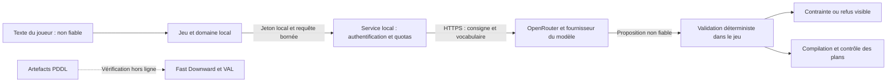

# Sécurité de la démonstration

Hordinary est une démonstration locale sur une machine de confiance. Le service n'est pas conçu
pour être publié sur Internet. Le code et les configurations du poste sont sous le contrôle de
l'opérateur ; une modification locale malveillante de ces fichiers sort de ce modèle de menace.

## Frontières de confiance



La clé OpenRouter reste dans le service. Le jeton local est partagé avec le jeu et protège les
appels facturés ; ce n'est pas la clé du fournisseur. Un processus capable de lire l'environnement
de ces applications reste dans la frontière de confiance du poste. Les consignes et le vocabulaire
du domaine sont envoyés au fournisseur : ne pas y saisir de données sensibles.

## Lancer une prise avec le modèle

Depuis PowerShell, dans la racine du dépôt :

```powershell
$env:HORDINARY_SERVICE_TOKEN = python -c "import secrets; print(secrets.token_urlsafe(32))"
# OPENROUTER_API_KEY doit déjà exister dans l'environnement du shell.
docker compose up -d --force-recreate service
# Lancer Godot depuis ce même shell pour lui transmettre le jeton local.
```

Le jeton contient au moins 32 caractères aléatoires ; ne jamais le versionner. Un éditeur Godot
déjà ouvert n'hérite pas des nouvelles variables du shell : le relancer depuis ce shell. En Python
direct, lancer `uvicorn app.main:app --host 127.0.0.1 --port 8001` depuis `service/` avec les mêmes
variables. Sans clé fournisseur, le mode de repli reste accessible sans jeton. Avec une clé mais
sans jeton, `/instruction` répond 503 ; un jeton absent ou erroné répond 401.

## Contrôles et limites

| Contrôle | Garantie et limite |
|---|---|
| Accès réseau | Compose publie uniquement sur `127.0.0.1`. Le jeton est exigé avant tout travail facturé. Le client refuse HTTP hors boucle locale et désactive les redirections automatiques. |
| Requêtes | Corps limité à 64 Kio, consigne à 4 000 caractères, contexte et listes bornés. `max_chars` ne peut pas désactiver la limite. Réponses de validation sans reprise des valeurs envoyées. |
| Charge | Dix requêtes par minute et une traduction simultanée par processus. Rejet immédiat lorsque le service est occupé. Utiliser un seul worker pour cette démo. |
| Coût | Cent appels fournisseur au maximum par processus, seuil en dollars observés et au plus une reprise de validation. Aucun retry automatique du SDK ; sortie bornée à 512 tokens. Un coût inconnu ou une panne fournisseur bloque les appels suivants. |
| Budget réel | Un appel peut dépasser le solde restant, et les compteurs repartent à zéro au redémarrage. Fixer aussi une limite financière sur la clé ou le compte fournisseur. Le harnais d'évaluation enlève volontairement les plafonds de montant et de nombre d'appels. |
| Contexte | Le cache inclut le digest complet, dont le glossaire et les contraintes actives. Le digest reçu par le service n'est pas authentifié indépendamment du jeton ; la validation finale utilise le domaine local du jeu. |
| Intégrité | Les empreintes SHA-256 servent au cache et à la traçabilité. Elles ne prouvent pas l'origine d'un fichier. Le dépôt ne fournit pas de signature cryptographique des configurations ou des binaires. |
| Fournisseur | Adresse limitée à HTTPS sur `openrouter.ai`, réglages numériques validés au démarrage. L'environnement du poste reste une entrée de confiance. |
| Conteneur | Utilisateur sans privilèges ; système de fichiers en lecture seule, capacités supprimées et ressources bornées dans Compose. |
| Dépendances | Versions testées dans `service/requirements.lock`, audit des vulnérabilités Python en CI, mises à jour proposées par Dependabot et actions CI épinglées par commit. Ce verrouillage ne constitue pas une signature des paquets. |

La validation syntaxique et le typage ne prouvent pas que la traduction respecte l'intention.
Une injection peut produire une contrainte formellement valide mais indésirable : le vocabulaire
fermé limite les effets possibles, sans garantir le refus de toute injection. L'affichage de la
contrainte et les évaluations adversariales restent nécessaires. Fast Downward et VAL corroborent
les artefacts hors ligne ; ils ne sont pas invoqués à chaque consigne pendant une partie.

## Vérification

Les tests `service/tests/test_security.py` vérifient l'authentification, les limites du corps et
du contexte, la saturation, les appels concurrents, les coûts inconnus, les réglages dangereux et
les erreurs sans fuite. Les tests C# vérifient l'invalidation du cache après changement du contexte.

Le corpus `service/evals/adversarial.jsonl` est réservé aux attaques de consigne. Son passage à vide
valide le harnais, sans mesurer la résistance d'un modèle :

```powershell
cd service
./.venv/Scripts/python.exe -m evals.run --corpus evals/adversarial.jsonl --dry-run
# Passage réel, facturé et sans plafond applicatif du harnais :
./.venv/Scripts/python.exe -m evals.run --corpus evals/adversarial.jsonl --repeat 3 --out evals/results.adversarial.md
```

Le harnais vérifie que ses sorties sont accessibles avant le premier appel. Pour le lancer avec
Compose sous Linux, reprendre l'UID et le GID du propriétaire du dépôt afin de conserver les droits
sur les rapports du dossier monté :

```bash
export HORDINARY_EVAL_USER="$(id -u):$(id -g)"
docker compose --profile evals run --rm evals --dry-run
```

Docker Desktop utilise par défaut l'identité sans privilèges `10001:10001`. Une sortie inaccessible
doit être corrigée avant une prise payante, avec les droits du dossier ou un autre chemin `--out`.

Un point de reprise du rapport et du manifeste est sauvegardé après chaque observation. Une panne
fournisseur ou un coût inconnu interrompt aussi les tirages suivants et termine avec le code 1 :
le rapport porte **INCOMPLET**, conserve les observations et ne publie aucun taux pour ce passage.
Un passage en cours conserve ce statut dans le manifeste jusqu'à sa fin.

Les mesures publiées avant ce durcissement décrivent la version alors testée. Les nouvelles bornes
de sortie et règles d'arrêt peuvent modifier latence, refus et coût : rejouer les évaluations avant
d'attribuer les anciens taux à cette version. Les passages futurs écrivent aussi un manifeste
`*.manifest.json` : empreintes du prompt, du digest et du corpus, modèle demandé, réglages publics
et versions des dépendances. Ce manifeste exclut les clés et jetons ; il sert à comparer les prises,
sans promettre une réponse identique du fournisseur.

Pour mettre à jour les dépendances : installer les versions choisies dans un environnement dédié,
exécuter les tests, régénérer `requirements.lock` avec `python -m pip freeze`, puis exécuter
`python -m pip_audit -r requirements.lock --no-deps --disable-pip`. Vérifier le diff avant publication.
